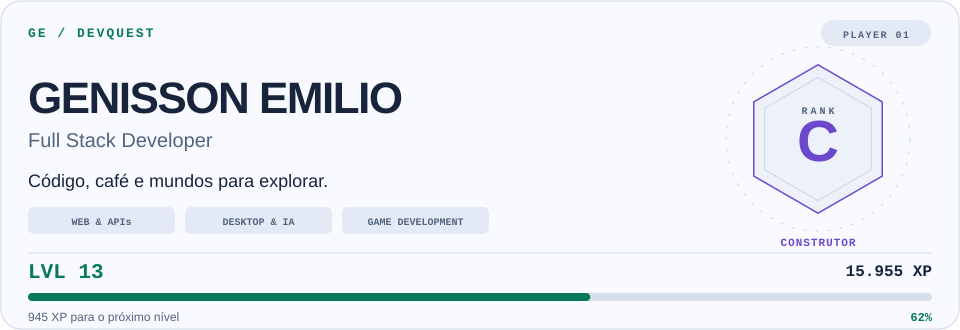
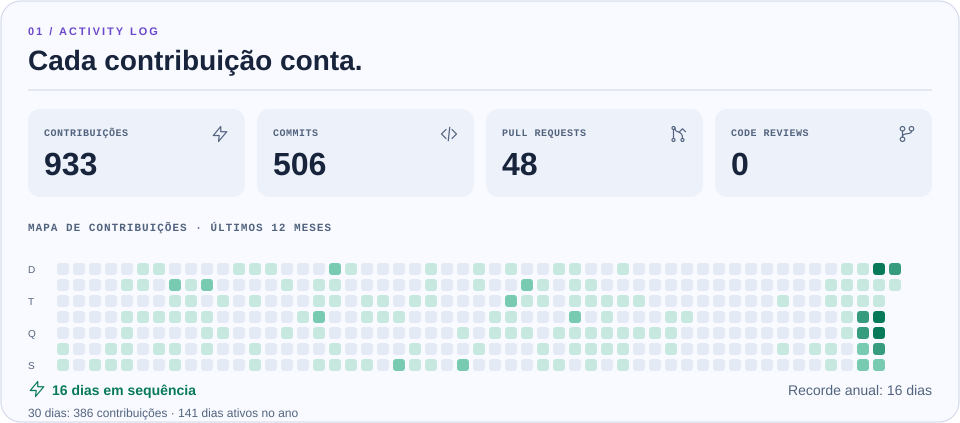
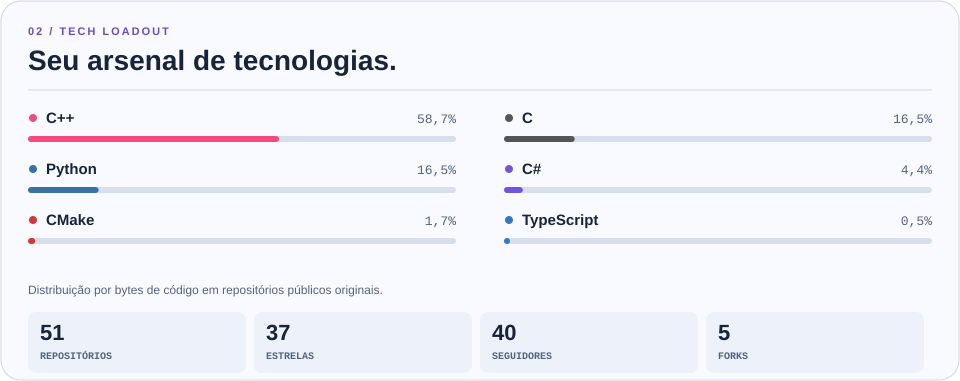
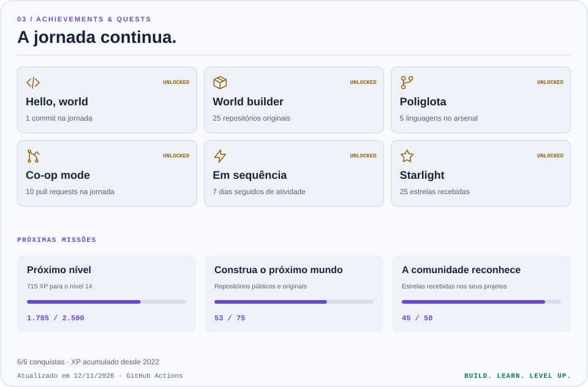

# GE / DevQuest

Seu GitHub como uma jornada de desenvolvimento: XP acumulado, níveis, patentes, conquistas e missões com dados reais.

[Ver no perfil](https://github.com/GenissonEmilio) · [Atualizações automáticas](https://github.com/GenissonEmilio/github_stats/actions/workflows/update-profile.yml) · [Dados](generated/stats.json)

<picture>
  <source media="(max-width: 600px) and (prefers-color-scheme: dark)" srcset="generated/hero-mobile-dark.svg">
  <source media="(max-width: 600px)" srcset="generated/hero-mobile-light.svg">
  <source media="(prefers-color-scheme: dark)" srcset="generated/hero-dark.svg">
  
</picture>

<picture>
  <source media="(max-width: 600px) and (prefers-color-scheme: dark)" srcset="generated/activity-mobile-dark.svg">
  <source media="(max-width: 600px)" srcset="generated/activity-mobile-light.svg">
  <source media="(prefers-color-scheme: dark)" srcset="generated/activity-dark.svg">
  
</picture>

<picture>
  <source media="(max-width: 600px) and (prefers-color-scheme: dark)" srcset="generated/arsenal-mobile-dark.svg">
  <source media="(max-width: 600px)" srcset="generated/arsenal-mobile-light.svg">
  <source media="(prefers-color-scheme: dark)" srcset="generated/arsenal-dark.svg">
  
</picture>

<picture>
  <source media="(max-width: 600px) and (prefers-color-scheme: dark)" srcset="generated/quests-mobile-dark.svg">
  <source media="(max-width: 600px)" srcset="generated/quests-mobile-light.svg">
  <source media="(prefers-color-scheme: dark)" srcset="generated/quests-dark.svg">
  
</picture>

## Funcionamento

Node.js 22+, sem instalação de pacotes. A API GraphQL fornece os dados e o gerador desenha 16 SVGs autossuficientes. O README escolhe automaticamente tema claro/escuro e composição para celular/desktop. Não há fontes, avatares ou ícones externos nas imagens.

O GitHub Actions solicita atualização diária às **07:17 de Fortaleza (10:17 UTC)**, em alterações no gerador e por **Actions → Update DevQuest → Run workflow**. O GitHub pode atrasar execuções ou desabilitar agendas de repositórios públicos após 60 dias sem atividade. Se a API falhar, o último painel publicado permanece disponível, com a data no rodapé.

## Regras do jogo

O XP usa o histórico desde a criação da conta, consultado ano a ano. Os indicadores de atividade mostram os últimos 365 dias; commits, PRs, issues e revisões usam o mesmo período.

| Ação contabilizada pelo GitHub | XP |
| --- | ---: |
| Commit de contribuição | 10 |
| Pull request aberto | 40 |
| Issue aberta | 15 |
| Revisão de código | 25 |

`nível = 1 + floor(sqrt(XP / 100))`. O nível N começa em `100 × (N − 1)²` XP. A barra mede o progresso dentro do nível atual. Estrelas, seguidores e quantidade de repositórios não aumentam XP.

| Nível mínimo | Patente |
| ---: | --- |
| 1 | E · Recruta |
| 5 | D · Explorador |
| 10 | C · Construtor |
| 20 | B · Especialista |
| 35 | A · Arquiteto |
| 50 | S · Lendário |
| 75 | S+ · Mestre |

A maior pontuação e as conquistas ficam salvas em `generated/stats.json`: menos histórico visível não retira progresso. Preserve esse arquivo. Trocar o usuário em `profile.config.json` inicia uma jornada independente.

As seis conquistas acompanham primeiro commit, 25 repositórios originais, cinco linguagens, dez PRs, sete dias consecutivos e 25 estrelas recebidas. A data registra a primeira observação da conquista pelo gerador. A conquista de sequência observa o recorde dos últimos 365 dias e permanece desbloqueada depois. As missões avançam ao atingir cada marco.

## Dados e limites

- Repositórios: todos os públicos de propriedade do usuário que não sejam forks, com paginação. Arquivados permanecem.
- Linguagens: proporção de bytes desses repositórios. As seis maiores aparecem; o denominador considera **todas**. Não representa domínio técnico.
- Estrelas e forks: totais recebidos nesses repositórios. Seguidores: total do perfil.
- Contribuições: calendário GitHub em UTC. A sequência aceita hoje vazio se ontem teve atividade.
- Contagens agregadas de atividade dependem da visibilidade do token. Um token pessoal pode mostrar agregados diferentes do `GITHUB_TOKEN` da rotina. Nomes, código e metadados de repositórios privados nunca são publicados.
- Patentes são uma mecânica deste projeto, sem ranking ou certificação oficial do GitHub.

## Uso local e personalização

```bash
# Token apenas no ambiente; nunca salvar no código ou no Git.
export GH_TOKEN="seu_token"
npm run generate
npm test
npm run check
```

A rotina recebe o `GITHUB_TOKEN` temporário do Actions automaticamente; não exige token pessoal. Só o trabalho de atualização recebe escrita no conteúdo deste repositório e publica apenas `generated/`.

Personalize `profile.config.json`. Para integrar a outro README, copie `generated/embed.md`. O perfil principal já usa os links permanentes: não precisa de commits diários no repositório de perfil. O README aplicado ao perfil está em [`docs/profile-readme.md`](docs/profile-readme.md).

O aplicativo Next.js original foi preservado em [`my-github-stats/`](my-github-stats/). O DevQuest tem um fluxo independente do endpoint antigo da Vercel.

## Validação

Testes cobrem limites de níveis, XP, conquistas, troca de usuário, sequências e ano bissexto, paginação, exclusão de privados, falhas da API, percentuais e as 16 variantes. `npm run check` verifica os artefatos antes da publicação.

Licença [MIT](LICENSE).

