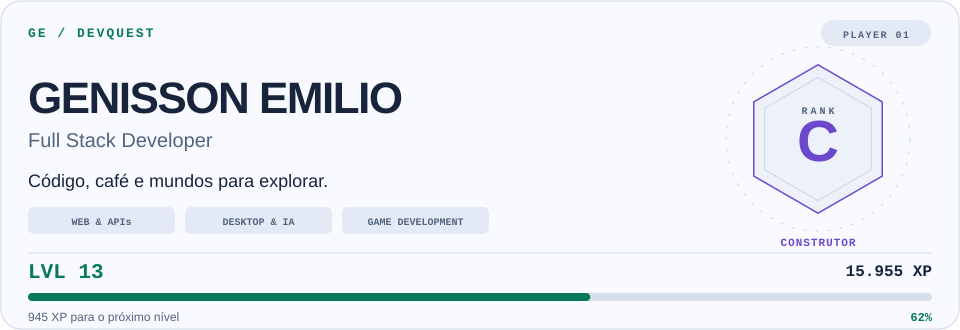
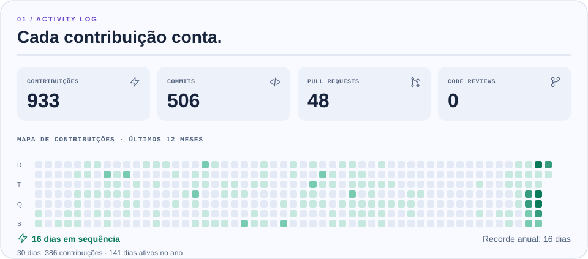
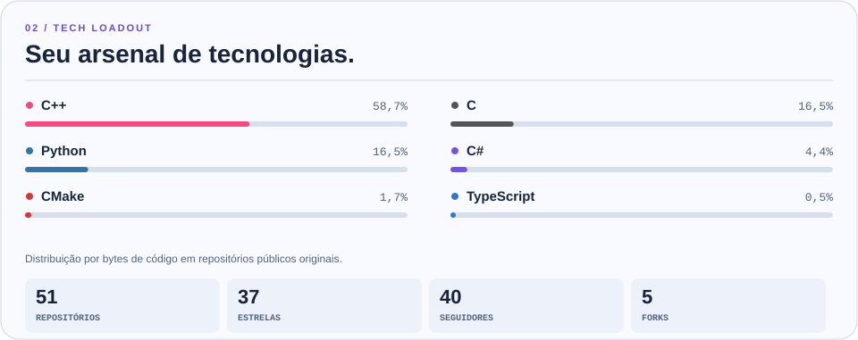
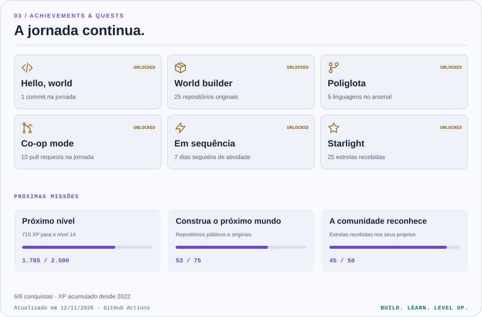

<!-- DEVQUEST:HERO:START -->
<picture>
  <source media="(max-width: 600px)" srcset="https://raw.githubusercontent.com/GenissonEmilio/github_stats/main/generated/hero-mobile-auto.svg">
  <source media="(prefers-color-scheme: dark)" srcset="https://raw.githubusercontent.com/GenissonEmilio/github_stats/main/generated/hero-dark.svg">
  
</picture>
<!-- DEVQUEST:HERO:END -->

  <a href="https://genissondev.mage.dev.br">Portfólio</a> ·
  <a href="https://www.linkedin.com/in/genisson-emilio">LinkedIn</a> ·
  <a href="mailto:officegenisson@gmail.com">E-mail</a> ·
  <a href="https://github.com/GenissonEmilio/github_stats">Como funciona o DevQuest</a>

### Olá, eu sou o Genisson.

Desenvolvedor **Full Stack** e estudante de **Ciência da Computação**, de Sergipe, Brasil. Transformo café em código e ideias em aplicações web, ferramentas desktop e experiências com jogos.

Meu foco passa por **JavaScript/TypeScript, React, Next.js e NestJS**, com base em **Python e Java**. Também exploro IA, visão computacional, IoT e desenvolvimento de jogos, estudando arquitetura de software e otimização de sistemas.

| Web & APIs | Desktop & Inteligência Artificial | Jogos & Sistemas |
| --- | --- | --- |
| TypeScript · React · Next.js | Python · IA · Visão computacional | C · C++ · C# |
| NestJS · Prisma · PostgreSQL | Aplicações para Linux e Windows | Godot · Ports nativos |

### Projetos que fazem parte da jornada

- [**Portfólio**](https://github.com/GenissonEmilio/Portfolio) — meu espaço na web, feito com Next.js e TypeScript.
- [**Cítrica**](https://github.com/GenissonEmilio/citrica) — conversão de arquivos offline para Linux e Windows, com interface, CLI e integração ao desktop.
- [**Metroid Prime Hunters PC**](https://github.com/GenissonEmilio/MetroidPrimeHuntersPC) — adaptação experimental para PC, com teclado, mouse e interface em uma tela.
- [**Shadow of the Colossus PC**](https://github.com/GenissonEmilio/ShadowOfTheColossusPC) — exploração de um port nativo para Linux.
- [**Forbidden Memories PC**](https://github.com/GenissonEmilio/ForbiddenMemoriesPC) — projeto de port nativo para PC com importação local de disco.

Os projetos de jogos usam arquivos fornecidos pelo próprio usuário; veja os requisitos em cada repositório.

### DevQuest / Estatísticas da jornada

Dados reais do GitHub, com progressão, conquistas e próximos objetivos. O XP é acumulado desde a criação da conta; os indicadores de atividade mostram os últimos 12 meses.

<!-- DEVQUEST:STATS:START -->
<picture>
  <source media="(max-width: 600px)" srcset="https://raw.githubusercontent.com/GenissonEmilio/github_stats/main/generated/activity-mobile-auto.svg">
  <source media="(prefers-color-scheme: dark)" srcset="https://raw.githubusercontent.com/GenissonEmilio/github_stats/main/generated/activity-dark.svg">
  
</picture>

<picture>
  <source media="(max-width: 600px)" srcset="https://raw.githubusercontent.com/GenissonEmilio/github_stats/main/generated/arsenal-mobile-auto.svg">
  <source media="(prefers-color-scheme: dark)" srcset="https://raw.githubusercontent.com/GenissonEmilio/github_stats/main/generated/arsenal-dark.svg">
  
</picture>

<picture>
  <source media="(max-width: 600px)" srcset="https://raw.githubusercontent.com/GenissonEmilio/github_stats/main/generated/quests-mobile-auto.svg">
  <source media="(prefers-color-scheme: dark)" srcset="https://raw.githubusercontent.com/GenissonEmilio/github_stats/main/generated/quests-dark.svg">
  
</picture>
<!-- DEVQUEST:STATS:END -->

Atualização diária · Tema claro e escuro · Versão para celular · <a href="https://github.com/GenissonEmilio/github_stats/actions/workflows/update-profile.yml">Status das atualizações</a>

<b>BUILD. LEARN. LEVEL UP.</b>

