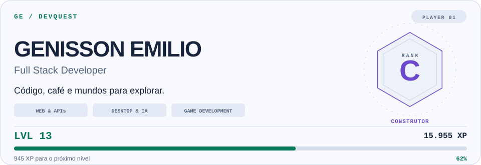
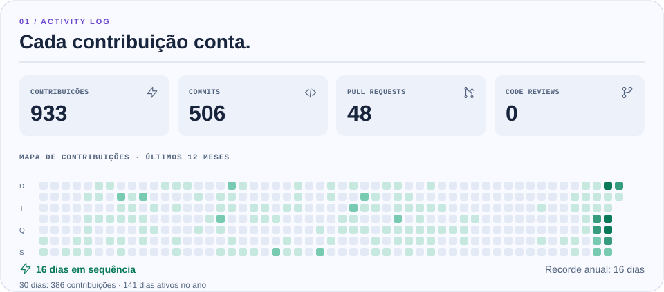
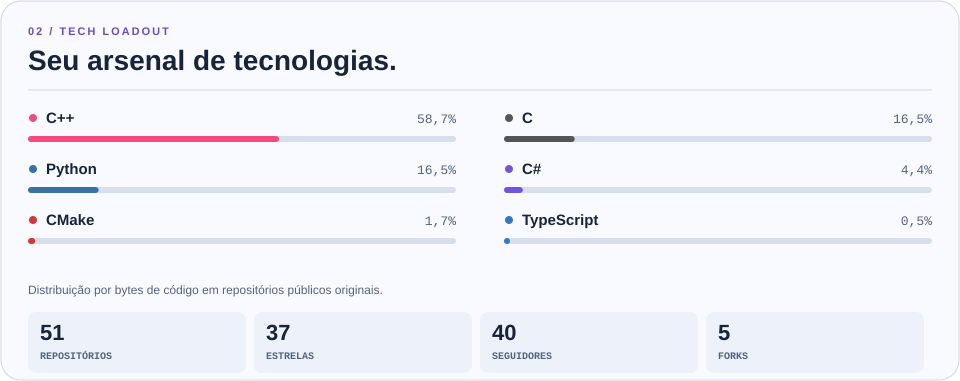
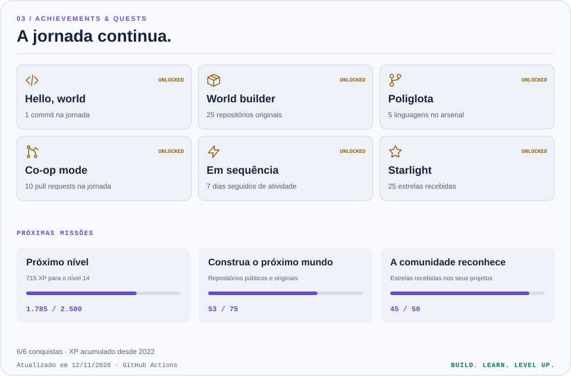

<picture>
  <source media="(max-width: 600px)" srcset="https://raw.githubusercontent.com/GenissonEmilio/github_stats/main/generated/hero-mobile-auto.svg">
  <source media="(prefers-color-scheme: dark)" srcset="https://raw.githubusercontent.com/GenissonEmilio/github_stats/main/generated/hero-dark.svg">
  
</picture>

<picture>
  <source media="(max-width: 600px)" srcset="https://raw.githubusercontent.com/GenissonEmilio/github_stats/main/generated/activity-mobile-auto.svg">
  <source media="(prefers-color-scheme: dark)" srcset="https://raw.githubusercontent.com/GenissonEmilio/github_stats/main/generated/activity-dark.svg">
  
</picture>

<picture>
  <source media="(max-width: 600px)" srcset="https://raw.githubusercontent.com/GenissonEmilio/github_stats/main/generated/arsenal-mobile-auto.svg">
  <source media="(prefers-color-scheme: dark)" srcset="https://raw.githubusercontent.com/GenissonEmilio/github_stats/main/generated/arsenal-dark.svg">
  
</picture>

<picture>
  <source media="(max-width: 600px)" srcset="https://raw.githubusercontent.com/GenissonEmilio/github_stats/main/generated/quests-mobile-auto.svg">
  <source media="(prefers-color-scheme: dark)" srcset="https://raw.githubusercontent.com/GenissonEmilio/github_stats/main/generated/quests-dark.svg">
  
</picture>
